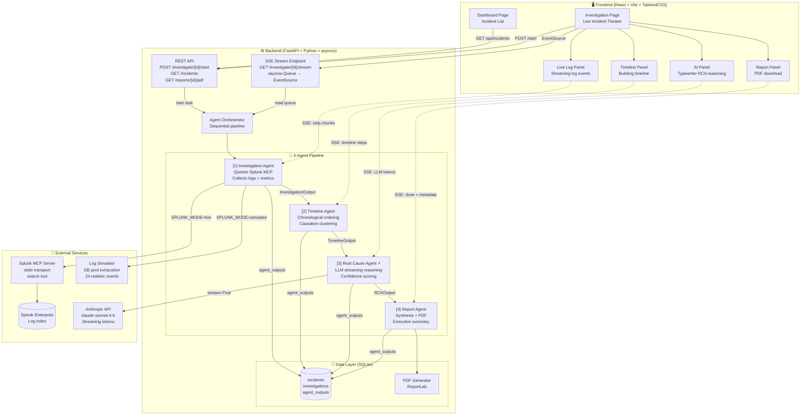
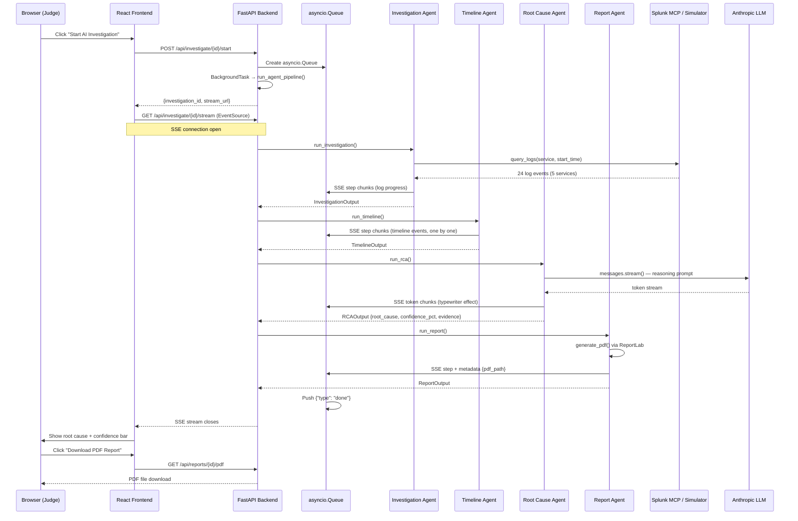
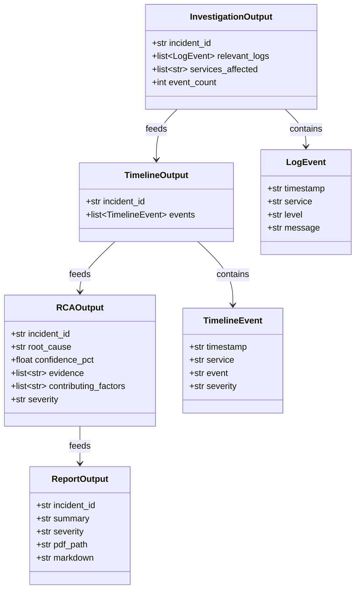

# Architecture Diagram — Autonomous Incident Commander

## System Architecture

---

## Data Flow

---

## Agent Data Contracts

---

## Component Summary

| Layer | Technology | Role |
|---|---|---|
| Frontend | React 18 + Vite + TailwindCSS | Dark SOC-style dashboard, SSE streaming UI |
| Backend | FastAPI + uvicorn | REST API, SSE stream, BackgroundTasks |
| Orchestrator | Python asyncio | Sequential 4-agent pipeline via asyncio.Queue |
| Agent 1 | Python + Splunk MCP SDK | Log collection from Splunk or simulator |
| Agent 2 | Python | Timeline construction from raw logs |
| Agent 3 | Anthropic claude-sonnet-4-6 | Streaming root cause analysis + confidence |
| Agent 4 | Python + ReportLab | PDF report generation |
| Splunk MCP | stdio transport | Tool-based Splunk Enterprise integration |
| Log Simulator | Python | Realistic 24-event DB exhaustion scenario |
| Database | SQLite + SQLAlchemy | Incidents, investigations, agent outputs |
| LLM | claude-sonnet-4-6 | Root cause reasoning with token streaming |

---

## Key Design Decisions

- **SSE over WebSockets** — EventSource is native to browsers, requires no library, and is one-directional (server → client), which is all that's needed for streaming agent progress.
- **asyncio.Queue as handoff** — `POST /start` creates the queue and launches the pipeline as a BackgroundTask. `GET /stream` reads from the same queue. No shared mutable state, no polling.
- **Plain asyncio over LangGraph** — 4 sequential agents with no branching need no graph library. Each agent `await`s the prior one's output and pushes chunks to the queue directly.
- **SQLite over PostgreSQL** — Zero setup, zero ops overhead, sufficient for all demo traffic. Swap to PostgreSQL in production by changing `DATABASE_URL`.
- **Simulator as first-class citizen** — `SPLUNK_MODE=simulator` is the default. The demo works identically whether Splunk Enterprise is present or not. The simulator generates realistic correlated logs that the AI cannot distinguish from real ones.
